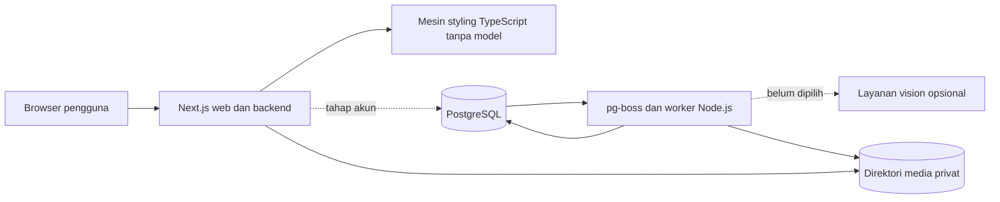

# StyleFit AI Architecture

## Status dan pilihan utama

Baseline versi 1.3 menargetkan biaya layanan/API Rp0 dengan mesin rekomendasi TypeScript buatan sendiri. Next.js menangani web; backend data dan admin ditambahkan pada tahap masing-masing. Landing dan stylist guest sudah diimplementasikan tanpa model lokal, API, database, atau login. Build ini belum merupakan rilis seluruh roadmap. Keputusan biaya dan batasnya ada pada COSTS.md.

| Komponen | Keputusan | Mulai digunakan |
| --- | --- | --- |
| Web dan backend | Next.js App Router, React, TypeScript, Tailwind CSS | Landing dan fondasi |
| Data utama | PostgreSQL, Drizzle ORM, driver node-postgres (`pg`), migrasi Drizzle Kit | Penyimpanan akun serta lemari |
| Auth | Better Auth dengan adapter Drizzle, session server, email/password | Akun; hashing, session, dan pemulihan memakai library |
| Media | Direktori privat `private-data/media`, dibaca melalui endpoint terotorisasi | Unggahan tersimpan; tidak berada di `public` |
| Mesin styling | Fungsi TypeScript deterministik pada `src/features/styling/engine.ts` | Aktif pada stylist guest; tanpa model atau jaringan inference |
| Multimodal | Belum dipilih atau diaktifkan; evaluasi cloud gratis bila kelak diperlukan | Analisis screenshot terpisah dari rekomendasi dasar |
| Antrean | Worker Node.js dan pg-boss pada PostgreSQL aplikasi | Pekerjaan berdurasi panjang; tanpa Redis terpisah |
| Layanan vision | Belum ada dependensi runtime Python/model | Diputuskan setelah kebutuhan dan provider layak dibuktikan |
| Landmark | MediaPipe | Scan opsional |
| Segmentasi | GroundingDINO dan SAM | Pemisahan pakaian yang diperlukan |
| Kemiripan | FashionCLIP dan pgvector | Pencarian visual |
| 3D | Three.js + WebGL 2, dimuat saat dipilih; studio GLB lokal dengan mesh dan tekstur pakaian terpisah | Avatar dan layering dasar |
| Photo try-on | Pipeline belum dipilih; nonaktif | T41 memerlukan provider, lisensi, resource, privasi, kualitas, dan biaya yang sesuai |
| Video | FFmpeg | Pemilihan frame |
| Cuaca | Input manual dahulu; MET Norway Locationforecast untuk otomatisasi | Tahap perjalanan, dengan cache dan atribusi |
| Paket dan lingkungan | Node.js 24 LTS, npm, lockfile; Docker ketika service membutuhkannya | Bootstrap dan layanan terkait |

Node.js 24 dipilih karena sudah tersedia di mesin dan berada pada jalur LTS. Pin dependensi stabil yang kompatibel saat bootstrap dan commit lockfile; hasil metadata registry bukan bukti instalasi atau build berhasil. Better Auth menyediakan [integrasi Next.js](https://better-auth.com/docs/integrations/next) dan [adapter Drizzle](https://better-auth.com/docs/adapters/drizzle); Drizzle mendukung [PostgreSQL melalui node-postgres](https://orm.drizzle.team/docs/get-started-postgresql).

Hosting belum dipilih dan Vercel tidak menjadi dependensi. Gunakan deployment Node.js biasa pada server yang mendukung proses worker dan volume persisten. Email pengujian ditangkap Mailpit lokal; email publik memakai SMTP yang sudah tersedia pada hosting atau layanan tanpa biaya yang syaratnya sudah diverifikasi. Pengiriman publik tetap merupakan prasyarat sebelum akun dibuka. Jangan memasang seluruh stack hanya untuk demo landing atau memakai prerelease hanya karena contoh dokumentasi menampilkannya.

## Konfigurasi dan akun

`.env.example` adalah kontrak konfigurasi target. Pada tahap 0 tidak ada rahasia atau layanan eksternal yang wajib. Periksa variabel saat fitur pemiliknya diaktifkan, bukan memaksa seluruh key agar demo bisa dibuka. Jangan mengimpor koneksi database atau client AI ke komponen demo bersama.

Konfigurasi dijaga oleh `scripts/check-zero-budget.mjs`: `STYLING_ENGINE=rules`, `AI_PROVIDER=none`, layanan berbayar false, key API dan endpoint/model inference kosong, database bila diisi hanya lokal, serta target media privat. Pemeriksaan dijalankan sebelum build dan dalam CI. Skrip bukan firewall. Alur aktif tidak mengimpor SDK/provider, membuka endpoint inference, atau mengunggah foto; tes browser memeriksa request saat demo dan handoff. Integrasi provider baru memerlukan perubahan kontrak, evaluasi, dan tes tersendiri.

Sebelum akun diaktifkan, siapkan database khusus StyleFit, secret session, origin yang benar, migrasi auth, dan validasi otorisasi server untuk setiap operasi. Cookie yang terlihat di browser tidak membuktikan session valid. Rute auth ditangani library; role admin ditentukan server dan tidak dapat diklaim lewat formulir pendaftaran atau body permintaan.

Email/password menjadi jalur awal akun. Pengiriman verifikasi email serta pemulihan password harus teruji sebelum akun dibuka ke publik. Pada pengujian lokal gunakan email sandbox dan akun fixture; jangan mengirim email ke pengguna nyata sebagai bagian tes otomatis.

Konfigurasi database yang sudah ada di mesin tidak dianggap milik aplikasi. Buat database serta akun dengan lingkup yang tepat pada T10 tanpa mereset atau memakai data layanan lain.

## Batas tanggung jawab

Browser menangani interaksi, demo lokal, input, dan rendering. Backend memvalidasi input, mengotorisasi akses, membaca data, menyusun aturan rekomendasi, menghitung harga, serta mengirim pekerjaan. Provider atau model membantu memahami gambar dan membuat visual; hasilnya melewati validasi sebelum menjadi data aplikasi.

AI dipakai dalam dua konteks berbeda: agen pengembang bekerja pada repositori; AI produk memproses permintaan pengguna melalui backend. Keduanya tidak berbagi izin atau kredensial secara otomatis.



Diagram mencakup layanan tahap lanjut. The guest path uses the browser and the TypeScript rules engine. The account path also uses PostgreSQL and Mailpit. Guest wardrobe data reaches the database only after the user chooses to import it.

## Struktur kode yang ditargetkan

```text
src/app/                 route, layout, dan endpoint web
src/components/          komponen UI yang benar-benar digunakan bersama
src/features/            fitur: demo, wardrobe, styling, inspiration, dan seterusnya
src/server/              session, akses data, aturan, dan integrasi server
src/workers/             pemrosesan antrean ketika diperlukan
services/vision/         layanan Python ketika diperlukan
public/demo/            aset demo berizin dan tidak sensitif
tests/                  tes yang menguji perilaku dan alur pengguna
```

Struktur ini adalah target, bukan direktori yang semuanya harus dibuat sekarang. Jaga aturan harga, kepemilikan, dan item terkunci pada fungsi domain yang bisa diuji terpisah dari provider.

## Kontrak data inti

- Setiap barang memiliki identifier stabil, kategori, atribut yang diketahui, dan sumber. Item lemari terikat ke pemilik; produk katalog memiliki referensi toko serta status pemeriksaan.
- Harga IDR disimpan sebagai integer rupiah atau kosong. Status verifikasi dan waktu pemeriksaan terpisah dari harga. Total tambahan hanya memakai pembelian yang benar-benar diperlukan.
- Permintaan styling membawa konteks, batas wajib, preferensi, dan identifier item terkunci. Backend mengambil atribut serta kepemilikan dari data yang diotorisasi, bukan mempercayai klaim browser.
- Hasil rekomendasi membawa identifier item, asal lemari/katalog, alasan, kebutuhan tambahan, dan informasi yang belum diketahui. Provider tidak menciptakan identifier katalog sendiri.
- Referensi memiliki sumber dan klasifikasi verifikasi. Representasi 3D membawa jenis spesifik/serupa serta pemetaan aset yang tersedia.
- Outfit dan packing mengacu ke identifier barang yang sama. Menghapus barang yang sudah dipakai outfit harus memberi keadaan item tidak tersedia atau aturan penghapusan yang jelas, tanpa menghapus outfit diam-diam.

## Alur guest dan pemindahan data

Tahap 0 membawa identifier fixture lewat URL yang divalidasi. Profil tubuh, foto, token session, dan rahasia tidak masuk URL. Pada tahap lemari, draft guest memakai memori client selama navigasi aplikasi; data pribadi tidak disimpan otomatis ke localStorage atau sessionStorage. Foto lokal memakai objek browser yang dilepas saat tidak lagi diperlukan. UI menjelaskan bahwa reload atau menutup tab dapat menghilangkan draft dan menawarkan login untuk menyimpan.

T10 mengimplementasikan draft tersebut pada state client yang bertahan selama navigasi internal, bukan variabel global server. Pemindahan ke akun dilakukan setelah login dan pilihan pengguna, divalidasi server, serta idempoten agar retry tidak menggandakan item. Server tidak menerima ownerId atau role dari draft sebagai otoritas. Menghapus draft dan berpindah akun tidak membuka data pengguna sebelumnya.

Jika analisis model disediakan untuk guest pada T21, sesi guest harus memiliki otorisasi pekerjaan sendiri, masa berlaku media, serta batas penggunaan. Analisis hanya diaktifkan setelah provider dan kebijakan data dipilih; request melewati backend yang memvalidasi akses, bukan mengekspos credential di browser. Perilaku tersebut diuji sebelum unggahan guest diaktifkan; hak memakai demo tidak otomatis memberi akses ke pekerjaan atau foto orang lain.

## Pekerjaan AI

Backend membuat pekerjaan setelah akses, input, dan batas penggunaan diperiksa. Worker memanggil provider atau model, memvalidasi hasil, lalu menyimpan status serta output yang boleh disimpan. Browser melihat status melalui endpoint yang diotorisasi.

Status yang ditargetkan: queued, running, succeeded, failed, dan cancelled. Identifier permintaan mencegah pengiriman berulang menghabiskan resource ganda. Retry memakai batas serta penanganan kegagalan yang jelas. Penghapusan data membatalkan pekerjaan terkait atau mencegah hasilnya disimpan kembali.

Koreksi atribut pengguna menjadi data terbaru. Hasil dari versi input lama tidak boleh menimpa koreksi baru. Kegagalan provider tidak diganti dengan hasil fixture tanpa label.

## Media dan privasi

Rahasia dan konfigurasi internal berada di server. Media pribadi tidak masuk direktori publik atau Git. Periksa format serta batas file dan tangani path media dari identifier yang diotorisasi, bukan path yang diberikan browser. Foto tubuh, foto lemari, referensi, dan output memiliki retensi masing-masing. Endpoint media membaca volume privat dan memeriksa session; lokasi tersebut harus persisten saat deployment.

Catatan proses memakai identifier dan status yang diperlukan, tanpa foto atau kredensial. Akses akun diuji pada setiap operasi data pribadi. Kebijakan penghapusan mencakup pekerjaan tertunda, volume media, layanan model, serta cadangan sesuai retensi yang dijelaskan.

## Lingkungan dan verifikasi

Development, staging, dan production menggunakan data serta kredensial terpisah. Tes memakai fixture yang diberi label; evaluasi model mendatang memakai data yang boleh diproses, dengan waktu, konsumsi memori, kualitas, dan keterbatasan tercatat.

T00 menyiapkan script nyata untuk lint, typecheck, test, dan build. Pengujian UI memakai Playwright ketika alurnya diimplementasikan; tes aturan domain memakai runner ringan seperti Vitest. Workflow CI ditambahkan bersama manifest yang bisa dijalankan, sehingga tidak ada workflow hijau yang hanya melewati pemeriksaan karena aplikasi belum ada.

Kontrak script pada bootstrap: `dev`, `build`, `start`, `lint`, `typecheck`, `test`, dan `test:e2e`. `lint` memanggil ESLint langsung; build Next.js tidak dianggap menjalankan lint. Tes otomatis tidak boleh lulus karena opsi yang membiarkan suite kosong. Browser Playwright dipasang pada lingkungan pengujian ketika T01-T02 dijalankan.

CI tahap 0 menjalankan instalasi dari lockfile, lint, typecheck, unit test yang relevan, build, dan tes browser demo tanpa secret provider. Gunakan izin repository minimum dan jangan memberi rahasia production pada kode PR. Workflow tersedia pada `.github/workflows/ci.yml`; hasil lokal dan hasil GitHub Actions dicatat terpisah.

## Referensi keputusan

- [Next.js Route Handlers](https://nextjs.org/docs/app/api-reference/file-conventions/route)
- [pg-boss](https://github.com/timgit/pg-boss)
- [MediaPipe Pose](https://developers.google.com/edge/mediapipe/solutions/vision/pose_landmarker)
- [MET Norway](https://api.met.no/doc/TermsOfService)
- [Kandidat try-on lokal dan batas lisensinya](COSTS.md)

## Implementasi rilis uji pertama

`src/features/demo/data.ts` memiliki fixture, preset, validasi query identifier, dan handoff. `src/features/styling/engine.ts` memiliki aturan kombinasi/harga/kunci; dipakai komponen stylist dan unit test. `src/features/wardrobe/guest-wardrobe.tsx` menyimpan draft pada context client di layout agar bertahan saat navigasi internal; tidak memakai global server atau browser storage. `src/features/styling/stylist.tsx` menangani input dan hasil rekomendasi. The account, wardrobe and lookbook paths use Next.js and PostgreSQL. Media, admin and AI provider routes remain future work. Batas browser 40 item membatasi pencarian kombinasi.

Next.js memakai build server standar; `npm run start` menjalankan hasil build beserta dependensi runtime. Tidak memerlukan Vercel. Bind default ke loopback untuk testing; hosting nanti menentukan reverse proxy, HTTPS, bind, environment, serta backup. Build lokal tidak berarti server sudah dideploy. `agentRules: false` mencegah `next dev` menambahkan instruksi generator ke AGENTS.md proyek.

ESLint 9.39.5 dipin karena peer dependencies plugin import/React/a11y pada konfigurasi Next.js belum menerima ESLint 10. Registry memberi peringatan dukungan ESLint 9 berakhir; ini alat development, bukan runtime web. Perbarui stack lint bersama plugin kompatibel, tanpa `--force` atau `--legacy-peer-deps`. Lockfile dan instalasi bersih menjadi bukti kompatibilitas praktis.

## Account and lookbook implementation

Better Auth verifies email and validates the session at each account operation. The server scopes every profile, wardrobe and lookbook query to that session. Mutations also check that the active session matches the account rendered in the tab. Registration, verification and password reset use a loopback SMTP sandbox. Public delivery and a public origin need a separate setup.

Drizzle migrations store accounts, wardrobe items, preferences and saved outfits. Guest imports use stable item IDs and a per-account transaction. Retrying the same import preserves existing items. Concurrent inserts respect the wardrobe limit. Saved outfits use IDs from the current wardrobe and deduplicate the same selection and context. A saved outfit shows missing items when a wardrobe entry has been deleted. Feedback and notes are stored with the look for later review.

## Curated inspiration catalog

The public explorer and stylist resolve published entries on the server. The bundled inspiration works without PostgreSQL. In an account-enabled environment, a row with the same slug overrides the bundled entry, including when unpublished. Catalog writes check the verified session against `STYLEFIT_ADMIN_EMAIL`; a stale form from another session is rejected.

Source URLs and editorial notes are data. The stylist uses the selected style and a small preference for the matching top color. Availability, locks, ownership, and budget rules stay authoritative.

## Browser-rendered avatar

The [bundled studio wardrobe](public/avatar/README.md) contains a portrait, hands, trousers, jeans, sneakers, leather shoes, two tops and one outer jacket. The existing item category, name and color select a similar mesh and tint. Unrecognized clothing names use the slot's default template. Changing a selection in the demo studio uses the current combination, respects locked pieces and keeps the view. The scene has separate inner garment panels for the jacket. Visibility changes never modify recommendations, cost or ownership.

The avatar supports 0–360° rotation, 80–130% camera zoom, 90–110% relative height, and 85–115% relative width. Relative controls scale the avatar and garments together. They do not take body measurements or calculate a size or physical fit. The client loads Three.js after selecting 3D and redraws on input and resize. Renderer and mesh resources are disposed when the viewer closes. WebGL failure returns to the existing 2D illustration.

The viewer decodes the local meshopt-compressed GLB on demand. Full-body, portrait and trouser framing use the same scene. The drama photo is a separate editorial reference. No user photo is used to construct the model.
